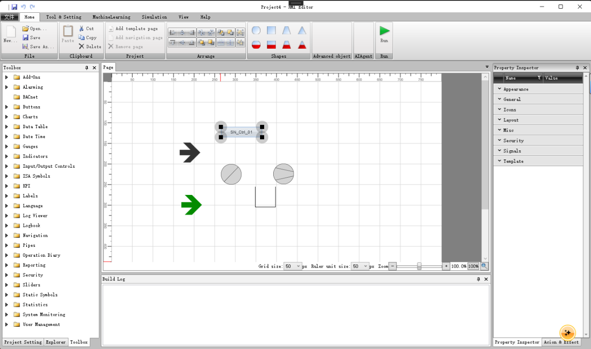
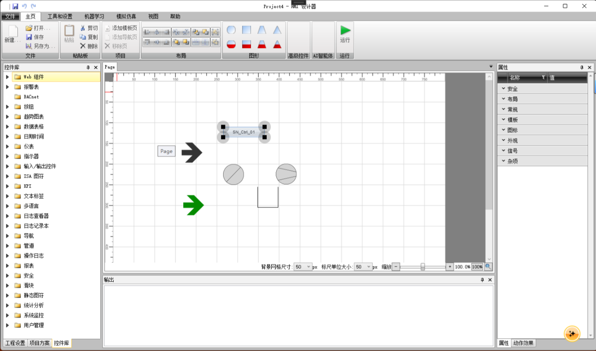
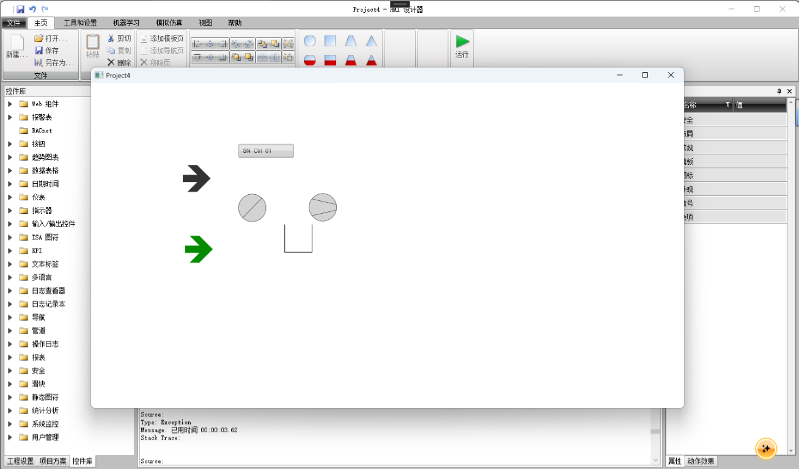

# ScadaViewer HMI

[简体中文](./README.md)

ScadaViewer HMI is a set of Windows desktop tools for creating, editing, building, and running SCADA HMI projects. The designer and primary runtime projects are built with WPF and target .NET 10.

## Screenshots

**Designer (English UI)**



**Designer (Chinese UI)**



**Runtime**



## Features

- **HMI.Editor**: WPF screen designer with project/solution management, a control tree, property editing, a design canvas, and build tooling.
- **HMI.Runtime**: WPF host used to debug the HMI runtime and runtime components.
- **HMI.RuntimeControls**: Reusable WPF controls for signal display/input, alarms, trends, data tables, ISA symbols, pipes, and primitives.
- **RapidSCADA communication**: Runtime communication layer provides signal read/write and subscriptions, plus historical trends, alarm history, and event queries.
- **Operation events and reports**: Operation Diary queries the RapidSCADA event stream. The reporting control queries historical channel values, operation events, or alarm history for a selected time range and exports local PDF/XLSX files.

Reports are generated from runtime data and do not require predefined TRDP/TRDX templates. Static symbols are serialized into generated project XAML content and do not require a separate runtime control type.

## Project layout

| Project | Responsibility |
| --- | --- |
| `HMI.Editor` | Designer entry point and application composition root |
| `HMI.ProjectDesigner.DesignControls` | Design-time controls, properties, and serialization |
| `HMI.Modules.*` | Designer modules such as canvas, browsers, property editing, project management, and build |
| `HMI.Runtime` | WPF host for debugging the runtime and runtime components |
| `HMI.RuntimeControls` | Runtime WPF controls and themes |
| `HMI.Runtime.Core` | Runtime connector and control contracts |
| `HMI.Runtime.Communication` | Communication API abstractions and RapidSCADA client |
| `HMI.Runtime.Shared` | Shared runtime control bases, state, and security behavior |
| `HMI.Runtime.Math` | Expression-related functionality |

## Technology

- C#, WPF, and .NET 10 for the designer and primary runtime projects
- Telerik UI for WPF `2025.2.521`
- Telerik Reporting `19.1.25.521` for local PDF rendering
- Open XML SDK `3.5.1` for XLSX export
- Microsoft.Extensions.DependencyInjection; designer services are composed through module registration
- RapidSCADA `ScadaCommon` client assemblies

## Requirements

- Windows
- .NET 10 SDK
- Visual Studio with the .NET desktop development / WPF workload, or the .NET CLI
- An accessible Telerik NuGet feed and applicable product licenses. Telerik Reporting licensing is required for report exports.
- RapidSCADA `ScadaCommon.dll` and `ScadaCommon.Log.dll`. `HMI.Runtime.Communication` references these assemblies through relative paths into the RapidSCADA source tree. Adjust the project references if your local directory layout differs.

## Build and run

Run from the repository root:

```powershell
dotnet restore .\HMI.Editor\HMI.Editor.csproj
dotnet build .\HMI.Editor\HMI.Editor.csproj -c Debug
dotnet run --project .\HMI.Editor\HMI.Editor.csproj
```

Build the runtime controls and project build module separately:

```powershell
dotnet build .\HMI.RuntimeControls\HMI.RuntimeControls.csproj -c Debug
dotnet build .\HMI.Modules.Build\HMI.Modules.Build.csproj -c Debug
```

## RapidSCADA configuration and security

Runtime connection settings are stored in `HMI.Runtime\ServerSettings.json`. The file contains fields for server names, hosts, ports, usernames, passwords, instances, keys, and timeouts. Configure it locally for the target environment. Do not commit production credentials or keys, or copy their values into tickets, logs, or README files. Follow the existing encryption/decryption convention and use an account with the least privileges required.

RapidSCADA features require a reachable server and an account authorized for the requested data queries and signal access.

## Implementation notes

- The designer, runtime debugging host, and primary WPF runtime control projects target .NET 10.
- Control behavior is defined by the current implementation; validate it in the target environment before release.
- Operation Diary reads the RapidSCADA event stream; it should not be treated as a complete independent audit log.
- Reports depend on the selected data type and data available from RapidSCADA. Excel output is an XLSX workbook; PDF output is rendered locally with Telerik Reporting.
- A successful build does not replace field validation of RapidSCADA connectivity, Telerik licensing, or deployment behavior. Run end-to-end checks in the target environment before release.

## Future plans

- Evaluate and incrementally add cross-platform designer and runtime support using Avalonia.

## Licensing and third-party components

The project code is licensed under the **GNU General Public License v3.0 (GPL-3.0-only)**. See the full text of the [GNU GPL v3.0](https://www.gnu.org/licenses/gpl-3.0.html).

Telerik, RapidSCADA, and other third-party components are not covered by this project's license and remain subject to their respective licenses. Verify applicable license terms, NuGet feed access, and deployment requirements before use or distribution.
