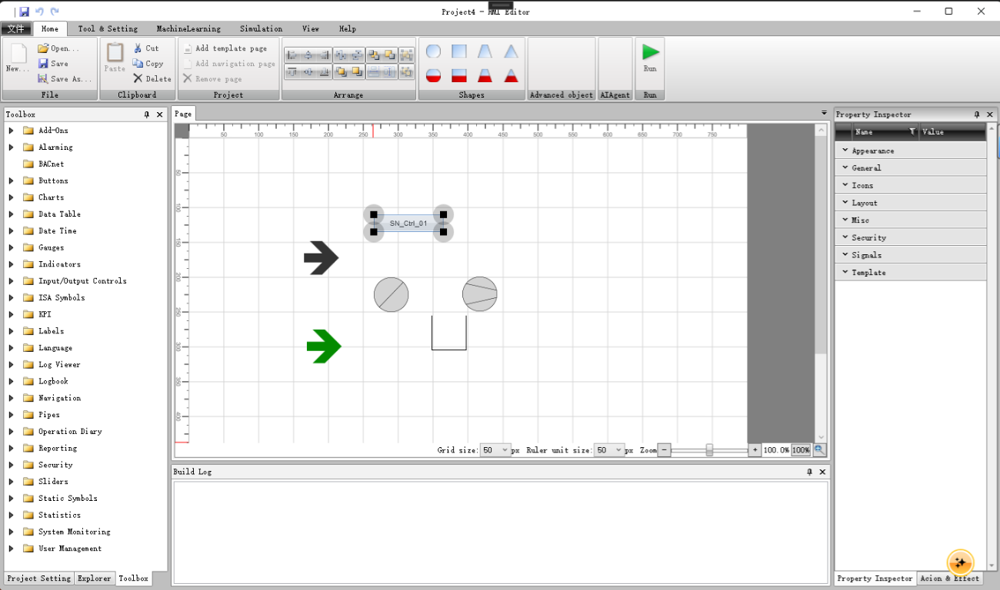
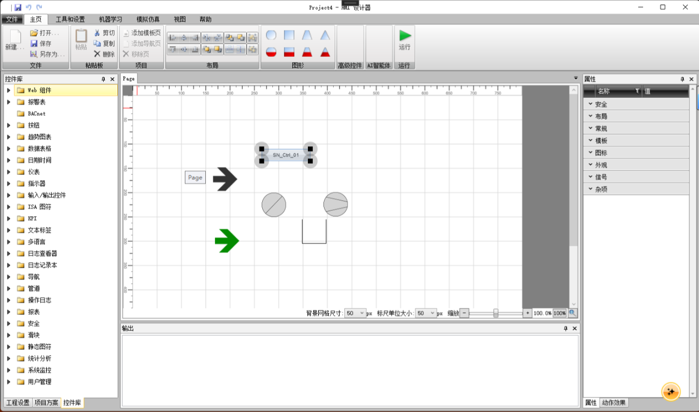
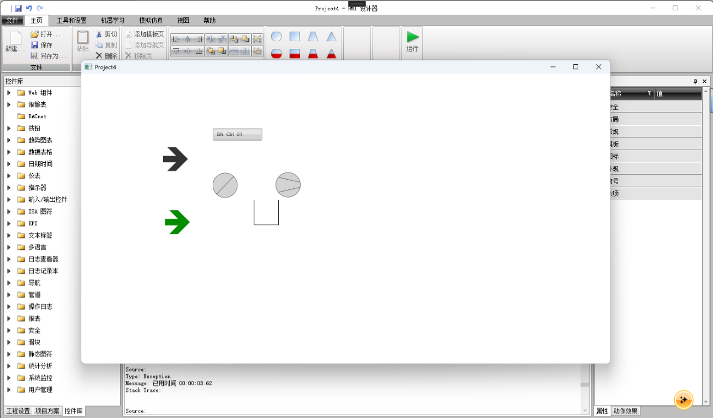

# ScadaViewer HMI

[English](./README.en.md)

ScadaViewer HMI 是一个用于创建、编辑、构建和运行 SCADA HMI 项目的 Windows 桌面工具集。设计器和主要运行时项目基于 WPF 与 .NET 10。

## 项目截图

**设计器（英文界面）**



**设计器（中文界面）**



**运行时**



## 功能概览

- **HMI.Editor**：WPF 画面设计器，提供项目/解决方案管理、控件树、属性编辑、画布编辑和构建模块。
- **HMI.Runtime**：用于调试 HMI 运行时及运行时组件的 WPF 宿主项目。
- **HMI.RuntimeControls**：可复用 WPF 控件库，包括信号显示与输入、报警、趋势图、数据表、ISA 图形、管道和基础图形等。
- **RapidSCADA 通信**：运行时通信层提供信号读写与订阅，以及历史趋势、报警历史和事件查询能力。
- **操作事件与报表**：Operation Diary 查询 RapidSCADA 事件流；报表控件可按时间范围查询通道历史值、操作事件或报警历史，并导出到本地 PDF/XLSX 文件。

报表采用运行时数据生成，不依赖预置 TRDP/TRDX 模板。静态符号由设计器写入生成项目的 XAML 内容，无需单独的运行时控件类型。

## 项目结构

| 项目 | 职责 |
| --- | --- |
| `HMI.Editor` | 设计器入口与应用组合根 |
| `HMI.ProjectDesigner.DesignControls` | 设计时控件、属性和序列化 |
| `HMI.Modules.*` | 设计器的画布、浏览器、属性编辑、项目管理及构建等模块 |
| `HMI.Runtime` | 用于调试运行时及运行时组件的 WPF 宿主 |
| `HMI.RuntimeControls` | HMI 运行时 WPF 控件及其主题 |
| `HMI.Runtime.Core` | 运行时连接器与控件契约 |
| `HMI.Runtime.Communication` | 通信 API 抽象及 RapidSCADA 客户端 |
| `HMI.Runtime.Shared` | 运行时控件共享基类、状态与安全功能 |
| `HMI.Runtime.Math` | 表达式相关功能 |

## 技术栈

- C#、WPF、.NET 10（设计器和主要运行时项目）
- Telerik UI for WPF `2025.2.521`
- Telerik Reporting `19.1.25.521`（本地 PDF 报表生成）
- Open XML SDK `3.5.1`（XLSX 导出）
- Microsoft.Extensions.DependencyInjection；设计器通过模块注册组合服务
- RapidSCADA `ScadaCommon` 客户端程序集

## 环境要求

- Windows
- .NET 10 SDK
- Visual Studio（安装 .NET 桌面开发 / WPF 工作负载）或 .NET CLI
- 可用的 Telerik NuGet 源及相应产品许可证。若使用报表导出，需确认许可证覆盖 Telerik Reporting。
- RapidSCADA `ScadaCommon.dll` 与 `ScadaCommon.Log.dll`。`HMI.Runtime.Communication` 项目通过项目文件中的相对路径引用 RapidSCADA 源码树下的程序集；如本机目录布局不同，请调整引用路径。

## 构建与运行

在仓库根目录执行：

```powershell
dotnet restore .\HMI.Editor\HMI.Editor.csproj
dotnet build .\HMI.Editor\HMI.Editor.csproj -c Debug
dotnet run --project .\HMI.Editor\HMI.Editor.csproj
```

单独构建运行时控件和项目构建模块：

```powershell
dotnet build .\HMI.RuntimeControls\HMI.RuntimeControls.csproj -c Debug
dotnet build .\HMI.Modules.Build\HMI.Modules.Build.csproj -c Debug
```

## RapidSCADA 配置与安全

运行时连接配置位于 `HMI.Runtime\ServerSettings.json`，其中包含服务器名称、主机、端口、用户名、密码字段、实例、密钥和超时等设置。请在本地按部署环境配置，不要将生产凭据或密钥提交到版本控制；也不要在工单、日志或 README 中复制其值。请遵循项目现有的加密/解密约定，并为目标环境配置最小权限账户。

RapidSCADA 功能要求目标服务器可连接，且账户具有对应的数据查询和信号访问权限。

## 实现说明

- 设计器、运行时调试宿主和主要 WPF 运行时控件项目以 .NET 10 为目标。
- 各控件的功能以当前实现为准；发布前应在目标环境验证运行行为。
- Operation Diary 的数据来源是 RapidSCADA 事件流；它与完整审计日志不是同一概念。
- 报表查询依赖所选数据类型及 RapidSCADA 数据可用性；Excel 使用 XLSX 工作簿，PDF 使用 Telerik Reporting 本地渲染。
- 构建结果不代表已完成目标现场的 RapidSCADA、Telerik 许可证和部署验证。发布前应使用目标环境执行端到端检查。

## 未来开发计划

- 评估并逐步支持使用 Avalonia 构建跨平台的设计器与运行时体验。

## 许可与第三方组件

本项目代码以 **GNU 通用公共许可证 v3.0（GPL-3.0-only）** 授权。许可证全文请参阅 [GNU GPL v3.0](https://www.gnu.org/licenses/gpl-3.0.html)。

Telerik、RapidSCADA 及其他第三方组件不属于本项目许可证授权范围，仍受其各自许可约束。使用、修改或分发前，请核实对应许可证、NuGet 源访问权限及部署条款。
